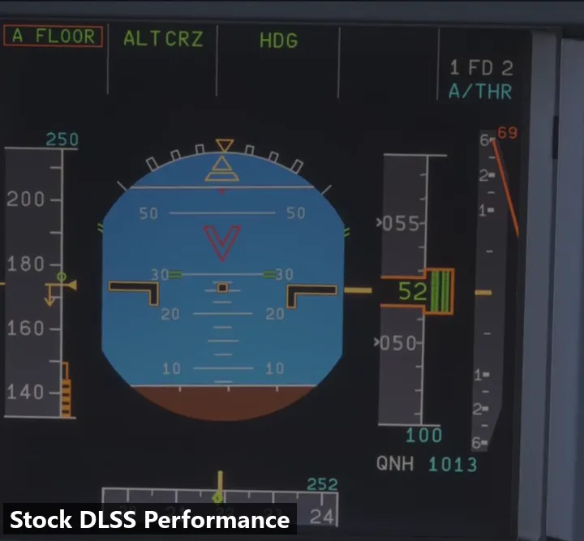

# Glass Cockpit DLSS Fix for MSFS 2024 (DLSS, FSR and VR)

Removes **upscaler ghosting and smearing from glass cockpit displays** in Microsoft Flight Simulator 2024: speed and
altitude tapes, moving maps, ECAM pages and so on stay sharp and readable with **DLSS or FSR**, in every quality mode,
on a monitor and in VR.

It comes in two versions with the same fix inside; pick one:

- **ReShade add-on** (`glass-cockpit-dlss-fix.addon64`), **recommended for now**: the proven version. Status and
  settings in a tab of the ReShade menu.
- **Standalone** (`dxgi.dll`), **early beta**: no ReShade needed, one file next to the sim. Status and settings in a
  small window of its own (**Ctrl+Shift+F6**, changeable).

*Fenix A320 at 4K, DLSS Performance (1080p internal, upscaled to 4K), climbing at about 6,700 ft/min.
[Watch in full quality on YouTube](https://www.youtube.com/watch?v=Hcz8hwFndoc).*

It works with every aircraft that uses the simulator's cockpit display shaders, so it should cover most glass
cockpits. See [Compatibility](#compatibility) for the tested aircraft, VR headsets and GPUs.

> Unofficial community mod. Not affiliated with Microsoft, Asobo, NVIDIA, AMD or any aircraft developer.
> Please report problems (see [Troubleshooting](#troubleshooting)). After 1.0.0, updates will be small hotfixes only
> for a while. The standalone version is new and still an early beta: if anything goes wrong with it, especially a
> crash, please report it, and use the add-on in the meantime.

**About this project:** Glass Cockpit DLSS Fix is developed by IFreemz. It was first released here on 11 October 2026
(v0.6.0), and every version since has been published from this repository. Official downloads: the
[GitHub releases](https://github.com/IFreemz/msfs2024-glass-cockpit-dlss-fix/releases) and the
[flightsim.to page](https://flightsim.to/addon/116678/glass-cockpit-dlss-fix-no-more-dlss-ghosting-on-pfd-nd). Other
packages, rebuilds or pages are unofficial; for those, please contact their authors.

## Contents

- [Requirements](#requirements)
- [Installation](#installation)
- [Settings](#settings)
- [Before you report a problem: what to try](#before-you-report-a-problem-what-to-try)
- [Compatibility](#compatibility)
- [Troubleshooting](#troubleshooting)
- [How the fix works](#how-the-fix-works)
- [Known limitations](#known-limitations)
- [Building from source](#building-from-source)
- [Credits](#credits)
- [License](#license)
- [Official downloads and redistribution](#official-downloads-and-redistribution)

## Requirements

- Microsoft Flight Simulator 2024, DirectX 12 (Steam or Microsoft Store / Xbox app). **MSFS 2020 is not supported**
  (see [Game versions](#game-versions)).
- **DLSS Super Resolution** (NVIDIA RTX) or **FSR** (any GPU) selected in the sim's graphics settings.
- ReShade add-on only: [ReShade](https://reshade.me) 6.7 or newer **with full add-on support** (the "with full add-on
  support" download)

## Installation

Install **one** of the two versions. If both are installed, the standalone version stays off.

The game folder is the one that contains `FlightSimulator2024.exe`:

- Steam: `...\steamapps\common\Microsoft Flight Simulator 2024\` (on some installs `...\steamapps\common\MSFS2024\`).
  To find it, right-click the game in Steam, then **Manage → Browse local files**.
- Microsoft Store / Xbox app: usually `C:\XboxGames\Microsoft Flight Simulator 2024\Content\`. To find it, open the
  Xbox app, right-click the game, then **Manage → Files → Browse**.

### ReShade add-on

Using [OptiShade](https://github.com/GamingWithGravy/OptiShade)? It already includes the add-on, see
[Other mods](#other-mods).

1. Install ReShade **with full add-on support** for MSFS 2024 (DirectX 10/11/12). You don't need any effects.
   In the ReShade setup, use **Browse...** and pick `FlightSimulator2024.exe` in the game folder.
   Microsoft Store / Xbox app: try `FlightSimulator2024.exe` first; if Windows refuses ("You don't have permission to
   open this file"), pick **`gamelaunchhelper.exe`** in the same folder instead: ReShade lands in the same place and
   loads with the sim. If setup says `dxgi.dll` already exists and doesn't belong to ReShade, another mod (e.g.
   OptiScaler or DLSS Enabler) is installed as `dxgi.dll`; see [Other mods](#other-mods) to load ReShade alongside it.
2. Download `glass-cockpit-dlss-fix.addon64` from the [latest release](../../releases/latest).
3. Copy it into the same folder as ReShade's DLL (the game folder).
4. Start the sim with DLSS or FSR selected and load a flight.

To check that it's working, open the ReShade menu (**Home** key) and go to the **Glass Cockpit DLSS Fix** tab: it
says "Working: fixing N screens" and shows a checklist. Or press **Ctrl+Shift+F11** in the cockpit: every screen it
fixes turns green-tinted. Press it again to turn the tint off.

**Update:** replace the `.addon64` file with the new one. **Uninstall:** delete `glass-cockpit-dlss-fix.addon64`
(and the `glass-cockpit-dlss-fix.*` files next to it).

### Standalone (no ReShade, early beta)

For one-click install and updates of the standalone, see WeSimGlide's installer under [Other mods](#other-mods).

1. Download `glass-cockpit-dlss-fix-standalone.zip` from the [latest release](../../releases/latest) and unzip it.
2. Copy `dxgi.dll` from it into the game folder.
3. Start the sim with DLSS or FSR selected and load a flight.

If Windows asks whether to replace an existing `dxgi.dll` there, **don't**: another mod (usually ReShade or
OptiScaler) is already using that name. Rename the fix's `dxgi.dll` to **`version.dll`** or **`winmm.dll`** instead
(whichever isn't taken in the game folder): it works the same under those names. Install it only once, under one name.
See also [Other mods](#other-mods).

To check that it's working, press **Ctrl+Shift+F6** in the sim: the settings window opens and says "Working: fixing N
screens" (the hotkey can be changed in the window). Or press **Ctrl+Shift+F11** in the cockpit: every screen it fixes turns green-tinted. Press it again to turn
the tint off. The file `glass-cockpit-dlss-fix-status.txt` next to the DLL also shows a checklist.

**Switching from the add-on?** Delete `glass-cockpit-dlss-fix.addon64`. If you used ReShade only for the fix,
uninstall ReShade too (its `dxgi.dll` is in the same folder). Your settings carry over: both versions use the same
`glass-cockpit-dlss-fix.ini`.

**Update:** replace `dxgi.dll` (or `version.dll` / `winmm.dll`, if you renamed it) with the new one, under the same
name. **Uninstall:** delete it and the `glass-cockpit-dlss-fix.*` files next to it.

## Settings

The add-on has all settings in its tab in the ReShade menu (**Home**). The standalone version has the same settings in a
small window of its own: press **Ctrl+Shift+F6** in the sim to open or close it (or click its X; hover over an
option to see what it does). It's a separate window rather than a menu drawn into the game, so it doesn't get in the
way of ReShade, OptiScaler or OptiShade menus, and it never takes the keyboard or mouse from the sim. If Ctrl+Shift+F6
clashes with another mod's hotkey, click it in the window and press a new combination (saved as
`[hotkeys] settings_window` in the `.ini`). Both versions keep the settings in `glass-cockpit-dlss-fix.ini` next to
the add-on or DLL, which lists every setting (the tables below say what each one does); you can also edit it with
Notepad while the sim runs: saved changes apply within a second.

| Setting (tab or window / `.ini`) | What it does |
|---|---|
| Fix enabled / `enabled` (Ctrl+Shift+F9) | Fix on/off, for comparison |
| Line smoothing / `line_smoothing` (0-50 %, default 35 %) | Smooths stair steps on thin slanted lines in the screens, like the upscaler did. 0 = sharpest, 50 = softest. In the tab, Ctrl+click to type a value. Tick **Extra** next to it (`extra_smoothing=1`) to go up to 100 % (blurs the whole screen; for screens with very jagged lines) |
| Green tint (Ctrl+Shift+F11) | Tints every screen the fix covers (for checking, not remembered) |

Under **Troubleshooting → Advanced** in the tab (the **Advanced** section of the standalone window), `[advanced]` and `jitter_positive` in the `.ini` (only change these if
asked to in a bug report; "Reset to defaults" in the tab puts them back):

| Setting (tab or window / `.ini`) | What it does |
|---|---|
| Flip jitter direction / `jitter_positive=0` | Only needed if the screen text shimmers when the camera is still |
| Glass layer / `glass_strength` (0-100 %, default 100 %) | How much of the sim's glass effects (dirt, glare, reflections, shadows) is kept on fixed screens. Lower values can help if quickly changing numbers leave a milky trail |

Under **Troubleshooting → Experimental fixes** in the tab (**Experimental fixes** in the standalone window), `[experimental]` in the `.ini` (**all off by default except
UV seam fix, Full-size sampling, Stable screen edges and Occlusion check**; for problems that only some aircraft have,
"Reset experimental fixes" in the tab puts them all back to
default):

| Setting (tab or window / `.ini`) | What it does |
|---|---|
| Full-size sampling / `full_size_sampling` (on) | Reads the screens only from their full-size picture, with more samples where a screen is small on your monitor. Off: also from the smaller copies the GPU keeps for distant screens, which can shimmer when you zoom out. **Ctrl+Shift+F7** switches it in the sim |
| Stable screen edges / `stable_edges` (on) | Keeps the pixels along each screen's edge from shimmering: where a screen ends is learnt over a few frames instead of judged anew every frame. Turn it off if a screen's edge looks cut off or too wide |
| Occlusion check / `occlusion_check` (on) | Leaves the sim's own picture wherever something sits in front of a screen (a sidestick, a hand, the yoke), using the sim's depth buffer. Off: a screen can be drawn over things in front of it, e.g. the A380 EFB over the sidestick |
| Calm glass at symbols / `calm_glass` (off) | Right next to symbols and digits, draws the glass effects (dirt, glare, reflections) without their finest detail, which can shimmer there. On some screens it can add shimmer instead, so it's off by default |
| Dark screen fix / `dark_screen_fix` (off) | Keeps very dark screens fixed in strong sunlight (e.g. the F/A-18E Super Hornet). Off by default because it can also let the fix draw over a screen whose picture it can't redraw |
| UV seam fix / `seam_fix` (on) | Removes thin dashed lines where a screen's picture meets a part of the same screen that uses another area of its image (FSS E-Jets: the line between the picture and its bezel band), and keeps those edges smooth on low DLSS modes. If a screen edge looks worse with it on, turn it off and please report the aircraft |
| Soft-edged line smoothing / `soft_smoothing` (off) | Line smoothing weighted towards each pixel's centre over a wider area: smoother screens with less shimmer while the view moves. Plain Line smoothing works well on most aircraft; this is an alternative if screens still shimmer while you move your head. A matter of taste; needs Line smoothing above 0 |
| Temporal anti-aliasing / `temporal_aa` (off) | Smooths screen text and lines over several frames, like the sim's own TAA, without the trails (the history is dropped wherever a screen's picture changes). Plain Line smoothing works well on most aircraft; this is an alternative if you want sharper text that still doesn't stair-step, with Line smoothing at 0-20. Uses about 100 MB more video memory at 4K. Not together with Soft-edged line smoothing |
| Edge trim / `edge_trim` (0-400) | The reverse of the edge stretcher: leaves the outer edge of every screen to the sim's own picture, in hundredths of a render pixel. For screens whose edge shows a sliver of something that isn't there, or jagged or flickering edges: **50 calms most flickering or shimmering screen edges**, up to 150 for aircraft with stronger edge problems. Within that band the upscaler's trails come back |
| Detail clamp / `detail_clamp` (0-100 %) | Keeps the fixed screens within the brightness the sim itself draws around each pixel. Hides texture detail too thin for the sim to show. **Can make screens flicker**, the more the lower the DLSS render resolution: almost none with DLAA and Quality, more with Balanced and Performance. Lower it if that bothers you, or if small text looks duller than with the fix off |
| Edge fade / `edge_fade` (0-250) | Fades screen edges into the sim's own picture, in hundredths of a render pixel (100 = 1 pixel). Can calm jaggy or crawling screen edges. Above about 200 it can flicker |
| Angle softening / `angle_softening` (0-100 %) | Draws screens seen at a steep angle softer, like the sim does. Screens seen straight on are unchanged |
| Edge stretcher / `edge_stretch` (0-400) | Extends screens outwards over their frame, in hundredths of a render pixel, continuing their picture. For screens that don't quite reach their frame |

The tab and the status file say "Experimental fixes changed" while any of them is on.

## Before you report a problem: what to try

Most visual problems on a particular aircraft can be fixed with a setting. Please try the ones below before opening an
issue: it's quicker for you, and if none of them helps, your report tells me exactly what was already ruled out.

### How to try a setting

1. In the cockpit, open the ReShade menu (**Home** key) and go to the **Glass Cockpit DLSS Fix** tab, or with the
   standalone version press **Ctrl+Shift+F6** for its settings window.
2. Open **Experimental fixes** (or **Advanced**). Hover over any option to see what it does.
3. Change one thing at a time and look at the problem screen for a few seconds. Changes take effect immediately and
   are remembered between sessions.
4. To compare with stock DLSS/FSR, toggle the whole fix with **Ctrl+Shift+F9**. **Ctrl+Shift+F11** tints every screen
   the fix covers green, so you can see which screens it handles.
5. Made it worse? **Reset experimental fixes** (or **Reset to defaults** under Advanced) puts everything back.

### Which setting for which problem

| What you see | Try first | Then |
|---|---|---|
| Screen edges flicker, shimmer or crawl, especially while moving | **Edge trim** 50 | Edge trim up to 150; Edge fade 100 |
| A sliver of something that isn't there along a screen's edge, or the edge looks cut off or too wide | **Edge trim** 50 | Untick Stable screen edges |
| A thin dashed or light line where a screen's picture meets its frame | Keep **UV seam fix** ticked | Detail clamp 100 |
| A screen doesn't quite reach its frame (a gap at the edge) | **Edge stretcher** 100 | Up to 300 |
| A screen is drawn over something in front of it (sidestick, hand, yoke) | Keep **Occlusion check** ticked | Report it with a capture |
| Small screens shimmer when you zoom out or lean back | Keep **Full-size sampling** ticked | Line smoothing 40-50 |
| Digits or symbols shimmer or sparkle, mostly in sun glare | **Calm glass at symbols** | Glass layer 50-70 % |
| Quickly changing numbers leave a milky trail | **Glass layer** 50-70 % | Calm glass at symbols |
| Text and lines look too jagged | **Line smoothing** 40-50 | Soft-edged line smoothing, or Temporal anti-aliasing with Line smoothing 0-20 |
| Text and lines look too soft or blurry | **Line smoothing** 15-25 | Untick Soft-edged line smoothing and Temporal anti-aliasing |
| A very dark screen drops out of the fix (green tint goes away) in strong sun | **Dark screen fix** | |
| Screens seen from a steep angle look sharper than the rest of the cockpit | **Angle softening** 50 | |
| Screen text shimmers even when the camera is completely still | **Flip jitter direction** (Advanced) | |

If a screen is never fixed at all (no green tint), settings won't help: see [What to send with a bug report](#what-to-send-with-a-bug-report).

## Compatibility

Both versions run the same fix; the results below were tested with the ReShade add-on unless noted. The standalone
version gets into the sim differently, so please report how it works for you.

### Aircraft

| Aircraft | Status |
|---|---|
| Fenix A320 family | Tested |
| FSLabs A321neo | Tested (1.0.1 or newer: 1.0.0 crashed the sim while loading it) |
| iFly 737 MAX 8 | Tested (every screen: CDUs, radio panels, transponder, ADF, MCP digits and both EFB tablets) |
| iniBuilds A220 | Tested |
| iniBuilds A330 | Tested |
| iniBuilds A340 | Tested |
| iniBuilds A350 | Tested |
| iniBuilds A380 | Tested |
| PMDG 737 | Tested by the community (also in VR) |
| PMDG 777 | Tested by the community (also in VR) |
| FlightFX C750 | Tested by the community |
| Default DA62 | Tested |
| Default Cessna 152 (BendixKing radios) | Tested |
| A2A Comanche 250 (radio displays) | Tested |
| Default Cessna Longitude | Tested by the community (in VR) |
| FSS E-Jets (ERJ-170/175/190/195) | Tested |
| Default F/A-18E Super Hornet | Tested (if its dark screens drop out of the fix in strong sun, turn on Dark screen fix, see [Settings](#settings)) |

Other glass cockpits should work too. If some screens of an aircraft don't turn green with Ctrl+Shift+F11, please
report it (see [Troubleshooting](#troubleshooting)).

### VR

No special install for VR: install either version exactly as for a monitor (for the add-on: ReShade for DirectX 12 with
full add-on support). The fix works inside the sim's own rendering, so it covers the headset views automatically.
ReShade's OpenXR / VR option is only for showing ReShade's own effects and menu in the headset and isn't needed.

| Headset | Status |
|---|---|
| Meta Quest 3 through Virtual Desktop | Tested with DLSS and FSR, foveated rendering on and off |
| Pimax Crystal Light | Tested by the community (DLSS) |

Other headsets and runtimes should work the same; reports welcome.

### GPUs and upscalers

| Setup | Status |
|---|---|
| NVIDIA RTX, DLSS Super Resolution | Tested, including DLSS Frame Generation up to 6x Multi Frame Generation |
| NVIDIA, FSR | Tested |
| AMD, FSR | Tested by the community on an RX 6800 XT and an RX 7800 XT |
| Intel, FSR | Untested, reports welcome |
| Any GPU, upscaler chosen in OptiScaler | Tested on NVIDIA with DLSS, FSR 2/3 and XeSS, and by the community on an AMD RX 9070 XT with DLSS selected and FSR 4 underneath, see [Other mods](#other-mods) |

### Game versions

Tested on the Microsoft Store / Xbox app (Game Pass) version and by the community on Steam.

**MSFS 2020 is not supported.** The fix finds the cockpit screens by how MSFS 2024 draws them, and I don't have
2020 to test or port it. The source is open (GPL-3.0 from 1.0.0), so a 2020 port by someone who has it is welcome.

### Other mods

- **ReShade presets and effects:** work as usual with the add-on. With the standalone version, ReShade can't be
  `dxgi.dll` at the same time: load it through an ASI loader (as `ReShade64.asi`) or through OptiScaler's
  `LoadReshade` option. Its effects then work as usual on top of the fix. (If you use ReShade anyway, the add-on is the
  simpler choice.)
- **DLSS 5 / Neural Rendering add-ons:** tested alongside the RenoDX DLSS 5 add-on. **Freeze warning:** with
  `renodx-dlss.addon64` installed, the sim can freeze when a Fenix aircraft loads. This happens with this fix removed
  too, so it's between RenoDX and the Fenix; if you get it, remove `renodx-dlss.addon64` (OptiScaler or OptiShade also
  offer Neural Rendering).
- **REX Atmos:** reported by a user: with Atmos' **Overall Light** at 0, fixed screens flickered in daylight (not at
  night). Setting it back to the default (16) stopped the flicker.
- **Extra DLSS passes:** if a mod or the sim runs a second DLSS pass at the internal resolution, the fix stays on the
  sim's real upscale (the one with the largest output).
- **Standalone DLSS Glass Cockpit Refresh** ([wesimglide.org](https://wesimglide.org/otherdata/tools/Standalone-DLSS-Glass-Cockpit-Refresh.html),
  [flightsim.to](https://flightsim.to/addon/116956/wsg-standalone-dlss-glass-cockpit-refresh-fix)): an unofficial
  installer and settings app by WeSimGlide. From its version 1.0.2.10 it installs the official standalone `dxgi.dll`
  from this page (checked against the release), keeps your `.ini` and backs up what it replaces, and its settings are
  the ones in the `.ini`. Problems with installing or with the app go to WeSimGlide; problems with the fixed screens
  come here. Older versions of it installed their own build instead: if you still have one of those, don't add either
  version of this fix on top (the fix would run twice).
- **[OptiShade](https://github.com/GamingWithGravy/OptiShade)** by Gravy: bundles the official, unmodified add-on (an OptiShade update with 1.0.0 is coming
  soon). Use one or the other, not both: with OptiShade, don't also install the `.addon64` or the `dxgi.dll` from here.
  Problems with OptiShade itself (installing, its presets and effects, updates) go to
  [OptiShade's issues](https://github.com/GamingWithGravy/OptiShade/issues); problems with the fixed screens come here.
- **Multi Frame Generation unlocks for RTX 40:**
  - **RenoDX MFG unlock add-on:** tested, works together with this fix.
  - **[RTX40MFG-Unlock](https://github.com/dashdogy/RTX40MFG-Unlock) by dashdogy:** works with either version (the fix
    follows its DLSS redirect).
    - Tested with v1.6.0 and the standalone version on its own: `MFGUnlocker.dll` renamed to `winmm.dll` next to the
      fix's `dxgi.dll`, nothing else needed; 3x Frame Generation with every screen fixed.
    - Tested earlier with v1.4.2 and the add-on (as `winmm.dll` next to an ASI loader's `version.dll`; `version.dll`
      alone works too).
    - Its Backspace menu didn't open in the sim in either test (with and without ReShade); it ran at 3x on its own.
      With 1.0.3 and newer, install the fix as `version.dll` instead of `dxgi.dll` (next to the unlocker's
      `winmm.dll`): the menu then works too (tested with v1.6.0).
    - **With OptiScaler, don't install it as `winmm.dll`:** the sim crashed at startup (the crash was in
      OptiScaler). Install it as an OptiScaler plugin instead, as its README describes (`MFGUnlocker.asi` in
      `OptiScaler\plugins`, `LoadAsiPlugins = true` in `OptiScaler.ini`); OptiScaler's menu then controls it.
- **OptiScaler:** works with any upscaler selected in OptiScaler (DLSS, FSR 2/3/4, XeSS), including OptiScaler's
  DLSS 5 Neural Rendering. On AMD and Intel GPUs this also lets you select DLSS in the sim and have OptiScaler run FSR
  or XeSS (tested on NVIDIA, and by the community on an AMD RX 9070 XT with FSR 4). OptiScaler is usually installed as
  `dxgi.dll`:
  - with the add-on, load ReShade through an ASI loader or through OptiScaler's `LoadReshade` option instead;
  - with the standalone version, keep OptiScaler as `dxgi.dll` and install the fix as `version.dll` or `winmm.dll`
    (1.0.3 and newer), or rename OptiScaler's `dxgi.dll` to another name it supports and keep the fix as `dxgi.dll`.
- **DLSS Enabler:** reported (4.9.0, installed as `version.dll`): with the standalone version the sim doesn't start;
  removing DLSS Enabler's `version.dll` fixed it. For more than 2x Frame Generation on RTX 40 cards, dashdogy's
  RTX40MFG-Unlock (above) works with both versions of this fix. With the add-on, not tested yet, reports welcome.
- **Standalone version as an `.asi` through an ASI loader:** don't (as `dxgi.dll`, `version.dll` or `winmm.dll` is fine). An ASI loader usually loads the DLL
  after the sim has set up its graphics, and then the fix can't see what it needs: screens will most likely stay
  unfixed (the log says so).

## Troubleshooting

First look at what the fix reports about itself: the add-on's **Glass Cockpit DLSS Fix** tab in the ReShade menu
(**Home**), or with the standalone version its settings window (**Ctrl+Shift+F6**) and
`glass-cockpit-dlss-fix-status.txt` next to the DLL (updated every 10 seconds while the sim runs). Both show what works and what doesn't (GPU, upscaler running, cockpit shader found, screens
recorded, fix drawn), explain any problem in plain words and give a report for bug reports (the tab's **Copy report**
button in the tab or window, the end of the status file). Both also have an **Open log folder** button.

For something you can *see* on fixed screens (flickering edges, shimmer, lines, blur, things drawn over), first try
the settings in [Before you report a problem: what to try](#before-you-report-a-problem-what-to-try).

### What to send with a bug report

| Problem | Send |
|---|---|
| The fix doesn't work at all, the tab or status file shows a problem, a screen is never fixed, a crash or freeze | **Both logs**: `glass-cockpit-dlss-fix.log` and `glass-cockpit-dlss-fix.old.log` (next to the add-on or DLL; **Open log folder** under Bug reports in the tab or the settings window). For screens that are never fixed, press **Screen probe** (under Bug reports) while looking at them first |
| Something you can see on fixed screens: wrong or changing colours, flicker, lines, jagged or blurry edges, trails | A **capture**: with the problem visible, press **Capture screens** (under Bug reports in the tab or the settings window), keep the screens in view for a few seconds, then attach the `glass-capture-....zip` that appears next to the logs. It already contains both logs |

Always mention which version you use (add-on or standalone), the aircraft, your DLSS/FSR mode, Frame Generation on/off
and other mods (OptiScaler, ReShade, RenoDX, MFG unlocks, OptiShade...).

**Using OptiShade?** Report problems with the fixed screens here, and problems with OptiShade itself (installing, its
presets and effects, updates) on [OptiShade's issues page](https://github.com/GamingWithGravy/OptiShade/issues). Not sure which? If the problem goes
away when you toggle the fix off with **Ctrl+Shift+F9**, it belongs here.

The **logs** are written every session: `glass-cockpit-dlss-fix.log` next to the add-on or DLL, and the previous
session as `glass-cockpit-dlss-fix.old.log` (if the sim crashed or you restarted it, the problem is in the `.old.log`).
The **capture** saves a few frames as pictures, cropped to the cockpit screens: what the sim drew, the upscaled frame
before and after the fix, and the frames sent to your monitor, plus a summary. It is only made when you press it and
costs nothing otherwise; nothing is uploaded anywhere.

The log lists which version it is, your GPU, driver, ReShade version (add-on), the DLSS/FSR files the sim loaded and
other mods, followed by milestones in order:

1. `milestone DLSS runtime found` / `FSR runtime found`
2. `milestone cockpit display shader found`
3. `milestone first DLSS frame` / `milestone first FSR frame`
4. `milestone first cockpit screen recorded`
5. `milestone first overlay frame drawn (fix is active)`

In VR also `milestone VR cockpit display shader found`, `milestone first VR cockpit screen recorded` and
`vr view order` lines.

The first missing milestone shows where it stopped. Lines starting with `WARNING` or `ERROR` explain common
problems in plain words, e.g. no upscaler selected, or a sim update that changed the display shader.

| Problem | Try |
|---|---|
| Add-on: no "Glass Cockpit DLSS Fix" tab in the ReShade menu | The add-on isn't loaded. If the ReShade menu has no **Add-ons** tab, reinstall ReShade with the *full add-on support* download. Check that the file is next to the ReShade DLL, and that **Settings → Add-on search path** in the ReShade menu points to that folder. |
| Standalone: no `glass-cockpit-dlss-fix.log` appears | The DLL isn't loaded. Check that it is named exactly `dxgi.dll` and is in the same folder as `FlightSimulator2024.exe` (Windows may hide the `.dll` extension: it must not be `dxgi.dll.dll`) |
| Standalone: log says the device was not seen, or "loaded after the sim created its graphics device" | The DLL was loaded too late, usually because it was loaded as `.asi` or another mod renamed it. Install it as `dxgi.dll` (or `version.dll` / `winmm.dll`) next to `FlightSimulator2024.exe` |
| Nothing changes, no green tint | Check that DLSS or FSR is selected (add-on: that ReShade is the *full add-on support* build and the file is next to the ReShade DLL). Then read the tab or status file, and the log. |
| Sim crashes while an FSLabs aircraft loads | Update to 1.0.1 or newer (1.0.0 only) |
| A screen briefly flashes very bright and fades back over a second or so (seen on the iniBuilds A380 and Fenix) | Update to 1.0.2 or newer (1.0.0 and 1.0.1 only) |
| Sim freezes when a Fenix aircraft loads, with RenoDX's DLSS add-on installed | Remove `renodx-dlss.addon64`; see [Other mods](#other-mods) |
| "Only DLSS Frame Generation is running" | Frame Generation is on but Anti-Aliasing isn't DLSS or FSR (e.g. TAA). Set Anti-Aliasing to DLSS (any mode, DLAA too) or FSR; Frame Generation can stay on |
| Some screens of an aircraft stay normal | Look at those screens in the cockpit, press **Screen probe** under Bug reports (writes a short diagnostic to the log), then send both logs and the aircraft name |
| Screen lines look jagged / too soft | Adjust Line smoothing |
| Dashed light line along the edge of a screen's picture (e.g. FSS E-Jets) | Keep **UV seam fix** on (`seam_fix=1`). If a line remains, try **Detail clamp** (can add some flicker on DLSS Balanced/Performance) |
| Dark screens drop out of the fix (green tint goes away) in strong sun | Turn on **Dark screen fix** (`dark_screen_fix=1`) |
| A screen is drawn over something in front of it (a sidestick, a hand, the yoke) | Make sure **Occlusion check** is on (`occlusion_check=1`, the default) |
| Screen edges flicker or shimmer, or show a sliver of something that isn't there | Set **Edge trim** to 50 (`edge_trim=50`; up to 150 for aircraft with stronger edge problems) |
| The log is called `glass-cockpit-dlss-fix-<number>.log` | Normal after flying some aircraft (e.g. Fenix): a helper program kept the usual log file open. Send the newest numbered log |
| Screen text shimmers when the camera is still | Turn on **Flip jitter direction** (`jitter_positive=0`). If it's already on (the tab or status file says "Advanced settings changed"), turn it off again (in the tab: **Reset to defaults**) |
| Screens flicker in daylight with REX Atmos installed | Set Atmos' **Overall Light** back to its default (16); at 0 it caused flicker (user report) |
| Screens flicker in brightness (G-Sync / FreeSync monitor) | VRR flicker from a changing frame rate, most visible on dark screens. Turn on V-Sync, or cap the frame rate a few fps below your refresh rate |
| Crash at startup | Remove the add-on or `dxgi.dll`, start once, put it back, then send both logs. With the standalone version (early beta), please report any crash, and use the add-on in the meantime |
| Standalone: Ctrl+Shift+F6 clashes with another mod's hotkey (e.g. a DLSS 5 add-on) | Click the hotkey in the settings window and press a new combination, or set `settings_window=` under `[hotkeys]` in the `.ini` (e.g. `Ctrl+Alt+G`) |

## How the fix works

DLSS and FSR build each frame from the history of previous frames, guided by motion vectors. A cockpit screen does
not move, but its *content* does, so the upscaler keeps blending old numbers into new ones. The game's own hint for
this (the animated-texture mask) isn't enough, and no DLSS preset (J, K, M) fixes it.

The fix uses the same idea that DLSS mods for other games use for HUDs: **draw the screen content after the
upscaler**.

1. When the sim draws a cockpit screen, the fix draws the same mesh once more into a small private map that records
   which part of which screen image lands on each pixel.
2. Right after DLSS or FSR, it samples the sim's own clean screen image at full output resolution (with the frame's
   camera jitter removed) and writes it over the upscaled result, so the moving content never goes through the
   upscaler's history.
3. Brightness is matched to the sim every frame, so night lighting and the brightness knobs still work. Dirt, sun
   glare and shadows on the glass are taken from the upscaled image itself, limited to what this frame actually
   shows, so they stay sharp while trails of old screen content are removed.

In VR the sim draws every view (both eyes, plus the sharp centre views with foveated rendering) in one go and then
upscales them one by one; the fix records each view separately and learns from the sim which upscale belongs to which
view.

To see what the sim draws, the ReShade add-on (1.0.x) uses ReShade's add-on events. The standalone version hooks the
few Direct3D 12 functions it needs itself: device and pipeline creation, root signatures, views, the command list calls
that bind pipelines, descriptor tables and render targets, the draws, and the swapchain's present; everything else goes
straight to Windows. It is loaded by Windows as the sim's `dxgi.dll` (it passes every call on to Windows' own
`dxgi.dll`) and sees the device being created. The source in this repository already builds both versions on the
standalone's hooks; the add-on will move to them once the standalone has had more testing.

It works at any resolution and in any quality mode, and costs one extra draw per screen plus a few small GPU passes:
no measurable FPS difference with the fix on or off in testing.

## Known limitations

- A screen whose picture the fix can't redraw is left to DLSS/FSR, so it looks like stock.
- A thin band at each screen's edge (about one render pixel) still comes from the upscaler (Edge fade and Edge
  stretcher under Experimental fixes can help on some aircraft).
- Anything that passes in front of a screen after the cockpit is drawn (e.g. hands in VR) is left to the upscaler by
  the Occlusion check (on by default); with it off, the screen is drawn over it.
- Standalone (early beta): not yet tested in VR. Its settings window opens on the desktop, not in the headset.
- Sim updates that change the cockpit display shader stop the fix (the sim then just looks like stock DLSS/FSR)
  until it is updated.

## Building from source

The full source is in this repository. See [BUILDING.md](BUILDING.md) to build both versions yourself.

## Credits

Glass Cockpit DLSS Fix by IFreemz. The standalone version (`dxgi.dll`) was built by
[Jason Tsorlinis](https://github.com/jtsorlinis). Thanks, Jason!

## License

From 1.0.0: GPL-3.0-only with additional attribution terms, see [NOTICE.md](NOTICE.md) and [LICENSE](LICENSE).
Versions up to 0.8.3 remain MIT. Third-party components are listed in [THIRD_PARTY_NOTICES.md](THIRD_PARTY_NOTICES.md).

## Official downloads and redistribution

The only official downloads are the [GitHub releases](https://github.com/IFreemz/msfs2024-glass-cockpit-dlss-fix/releases)
(each release lists the SHA-256 checksums of its files) and the [flightsim.to page](https://flightsim.to/addon/116678/glass-cockpit-dlss-fix-no-more-dlss-ghosting-on-pfd-nd). OptiShade bundles the official add-on with explicit permission (see [NOTICE.md](NOTICE.md)).

You may redistribute and modify the add-on under the GPL-3 terms. In short, for builds that contain 1.0.0 or later code:

- Keep the licence, NOTICE.md and the credit "Glass Cockpit DLSS Fix by IFreemz" with the link to this repository.
- If you change the code or build it into another program, that program must be released under GPL-3 as a whole,
  with its source available.
- Mark modified or repackaged builds as unofficial, under a different name or version, and handle their support
  yourself.

Requests (not licence conditions): please also credit the project visibly on your own download page and in your
program's interface, link to the official releases, and let me know about your build so I can point people to the
right place for support.

If an antivirus flags a download, check that it came from the official releases and that its SHA-256 matches.

**Using AI agents or other automated tools to build on this project** (a wrapper, an installer, a bundle): see
[AGENTS.md](AGENTS.md) for the licence terms in short.
